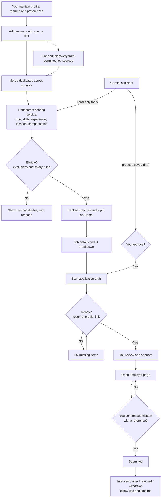

# Personal Job Assistant — Workflow

Release: **V 0.3.0**. Dashed steps are planned; see the [module tracker](MODULE_TRACKER.md).

## Gemini controller

Gemini interprets the question and picks tools. The backend validates every argument, scopes data to the local user, and turns any change into a pending action you approve. Tools: `search_jobs`, `get_job_details`, `get_user_profile`, `calculate_job_match`, `compare_jobs`, `analyze_skill_gaps`, `list_applications`, `get_application_status`, `propose_save_job`, `propose_application_draft`. There is no submission tool.

## Operating rules

- Equal priority for credit risk, market risk, investment banking, AI/software and fintech roles; Global Capability Centres included.
- Mid-level to AVP; Indian metros including Bengaluru and Pune; remote, hybrid or on-site.
- ₹25 LPA total CTC minimum; ₹20 LPA for Google, Microsoft, Meta, Amazon, Apple and Netflix by exact name. Undisclosed salaries remain eligible.
- Showcase https://github.com/Taps-m and https://dastapomoy.com/ in tailored materials; never invent links or project claims.
- Reword and reorder verified facts only; ask before adding any new factual claim.
- Two-month notice. Clarify work authorization when an application requires it.
- Record a submission only after confirmation.
- Keep personal records, resumes and credentials out of Git.
- Number every release **V x.y.z** and update the tracker and changelog with it.
